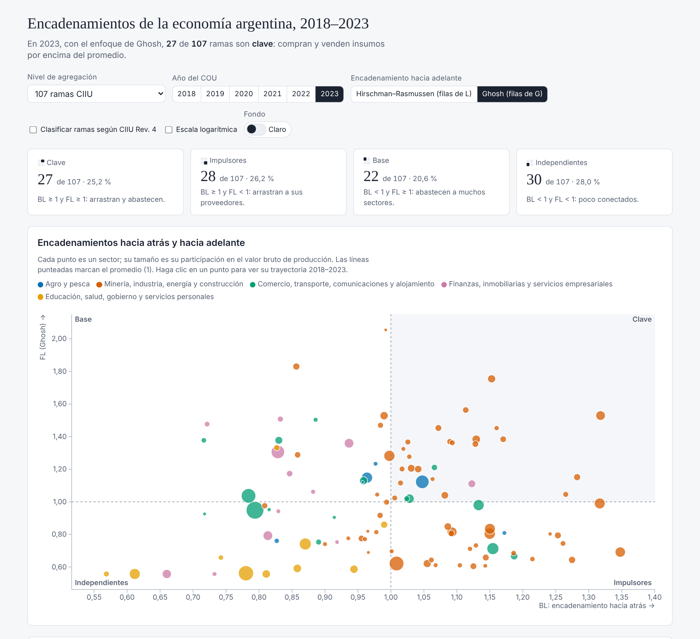

# mip-cou-argentina

**Matrices insumo-producto de la Argentina estimadas a partir de los cuadros de oferta y utilización (COU) del INDEC, 2018–2023, en R.**

El proyecto transforma los COU publicados por el INDEC en **matrices insumo-producto (MIP) simétricas de flujos domésticos a precios básicos**. Con esas matrices calcula los coeficientes técnicos $\mathbf{A}$, la inversa de Leontief $\mathbf{L}=(\mathbf{I}-\mathbf{A})^{-1}$, multiplicadores (producción, valor agregado, importaciones e impuestos) y encadenamientos hacia atrás y hacia adelante (Rasmussen–Hirschman y Ghosh). Trabaja con varios niveles de agregación de ramas y de productos, y permite reclasificar las ramas de la CIIU Rev. 3 (la del INDEC) a la CIIU Rev. 4.

La última MIP oficial de la Argentina corresponde a 1997. Desde entonces, el INDEC publica COU, que **no equivalen a una MIP**: este código explicita los supuestos necesarios para pasar de unos a otra.

Material elaborado para la asignatura *Cuentas Nacionales* (Contador Público, Universidad Nacional de Río Negro, Sede Atlántica), Unidad 04 — Matriz insumo-producto.

### 📊 [Ver el tablero interactivo de encadenamientos](https://fcontiggiani.github.io/mip-cou-argentina/docs/index.html)

<a href="https://fcontiggiani.github.io/mip-cou-argentina/">
  <picture>
    <source media="(prefers-color-scheme: dark)" srcset="docs/img/tablero_oscuro.png">
    
  </picture>
</a>

<sub>Encadenamientos hacia atrás (BL) y hacia adelante (FL, Ghosh) de 107 ramas en 2023. Permite elegir el nivel de agregación, el año, el enfoque y la clasificación CIIU Rev. 3 o Rev. 4, y cambiar entre fondo claro y oscuro. Detalles en [Tablero interactivo](#tablero-interactivo-github-pages).</sub>

---

## Contenido

- [Resultados principales](#resultados-principales)
- [Estructura del repositorio](#estructura-del-repositorio)
- [Requisitos e instalación](#requisitos-e-instalación)
- [Datos](#datos)
- [Uso](#uso)
- [Tablero interactivo (GitHub Pages)](#tablero-interactivo-github-pages)
- [Método](#método)
- [Controles de consistencia y pruebas](#controles-de-consistencia-y-pruebas)
- [Limitaciones](#limitaciones)
- [Cómo citar](#cómo-citar)
- [Licencia](#licencia)
- [Referencias](#referencias)

---

## Resultados principales

**Multiplicador de valor agregado** ($\mathbf{v}'\mathbf{L}$): valor agregado que genera toda la economía por cada peso de demanda final del sector. MIP rama × rama de 107 ramas agregada a 5 grandes sectores. Los valores son adimensionales.

| Gran sector | COU reducido 2018 | 2018 | 2019 | 2020 | 2021 | 2022 | 2023 |
|---|---:|---:|---:|---:|---:|---:|---:|
| Agro y pesca | 0,831 | 0,851 | 0,843 | 0,856 | 0,854 | 0,864 | 0,863 |
| Minería, industria, energía y construcción | 0,776 | 0,793 | 0,794 | 0,793 | 0,781 | 0,789 | 0,803 |
| Comercio, transporte, comunicaciones y alojamiento | 0,867 | 0,869 | 0,868 | 0,879 | 0,872 | 0,876 | 0,876 |
| Finanzas, inmobiliarias y servicios empresariales | 0,918 | 0,910 | 0,902 | 0,902 | 0,899 | 0,901 | 0,893 |
| Educación, salud, gobierno y servicios personales | 0,926 | 0,917 | 0,909 | 0,911 | 0,907 | 0,915 | 0,920 |

*Fuente: elaboración propia sobre INDEC, cuadros de oferta y utilización 2018–2023, y COU 2018 reducido (INDEC, 2021).*

- El PIB que reconstruye cada MIP coincide con el publicado por el INDEC en los seis años. En 2018 es de 14.744.811 millones de pesos.
- **Sesgo de agregación.** Aplicar los mismos supuestos sobre el COU reducido (10 grupos de productos) en lugar del COU completo (223 productos) cambia los resultados. El multiplicador de producción de la industria pasa de 1,90 a 1,84, y en la tipología de Hirschman la industria pasa de «clave» a «impulsora».
- **Entre 2018 y 2023**, la industria gana arrastre como compradora de insumos: su multiplicador de producción sube de 1,90 a 1,98. Las filtraciones por importaciones bajan en todos los sectores en 2023.

Las tablas completas, para 107 ramas y todos los indicadores, están en [`salidas/comparacion_mip_cou_2018_2023.xlsx`](salidas/comparacion_mip_cou_2018_2023.xlsx).

## Estructura del repositorio

```
mip-cou-argentina/
├── R/
│   ├── 01_cou_datos.R            # Objeto "cou" y datos del COU 2018 reducido (10 productos × 5 ramas)
│   ├── 02_leer_cou_indec.R       # Descarga, inspección y lectura automática de los COU del INDEC
│   ├── 03_validaciones.R         # Identidades contables del COU y de la MIP; condición de Hawkins–Simon
│   ├── 04_cou_a_mip.R            # Precios básicos, importaciones, ajuste CIF/FOB y modelos B y D
│   ├── 05_analisis_mip.R         # A, L, multiplicadores, encadenamientos e impactos
│   ├── 06_exportar.R             # Exportación a Excel y CSV
│   └── 07_agregacion.R           # Correspondencias CIIU/CPC, CIIU Rev. 3 -> Rev. 4 y agregación de la MIP
├── tests/
│   ├── testthat.R                # Ejecuta todas las pruebas
│   └── testthat/
│       ├── helper-cargar.R       # Carga las funciones del proyecto
│       └── test-mip.R            # 37 pruebas: ejemplo didáctico, identidades, agregación, márgenes, CIIU Rev. 4
├── datos/
│   ├── correspondencia_ciiu3_ciiu4.csv  # 107 ramas del COU -> sección CIIU Rev. 4 (exacta / aproximada)
│   └── COU/                      # Libros del INDEC sh_cou_AAAA_*.xls (no incluidos; ver «Datos»)
├── salidas/
│   ├── comparacion_mip_cou_2018_2023.xlsx   # Comparación de indicadores 2018–2023
│   ├── encadenamientos_2018_2023.json       # BL y FL por nivel y año (insumo del tablero)
│   ├── encadenamientos_2018_2023.csv        # Lo mismo, en CSV
│   ├── mip_2018_reducida_ramaxrama.xlsx     # MIP 5 × 5 del COU reducido (modelo D)
│   ├── mip_2018_reducida_prodxprod.xlsx     # MIP 10 × 10 del COU reducido (modelo B)
│   └── mip_cou_2018_107ramas.xlsx           # MIP 107 × 107 de 2018 (script autocontenido)
├── docs/                         # Tablero interactivo, publicable con GitHub Pages
│   ├── index.html                # Página del tablero (HTML, CSS y JavaScript)
│   ├── datos/
│   │   └── encadenamientos_2018_2023.js     # Datos del tablero (los genera exportar_encadenamientos.R)
│   ├── img/
│   │   ├── tablero_claro.png     # Captura del tablero (tema claro) para este README
│   │   └── tablero_oscuro.png    # Captura del tablero (tema oscuro)
│   ├── vendor/
│   │   ├── d3-7.9.0.min.js       # Biblioteca d3 incluida localmente (funciona sin conexión)
│   │   └── LICENSE-d3.txt        # Licencia de d3 (ISC)
│   └── .nojekyll                 # Indica a GitHub Pages que publique los archivos tal como están
├── main.R                        # Ejemplo completo con el COU 2018 reducido
├── estimar_mip_cou_2018.R        # Script autocontenido y didáctico: MIP 2018 de 107 ramas desde el libro del INDEC
├── comparar_cou_anuales.R        # MIP de 107 ramas por año y comparación con el COU reducido
├── exportar_encadenamientos.R    # Encadenamientos por nivel de agregación y año
├── CITATION.cff
├── LICENSE
└── README.md
```

Todo el código está **comentado línea por línea** en español, porque el proyecto tiene una finalidad didáctica.

## Requisitos e instalación

- **R ≥ 4.1**: el código usa la tubería nativa `|>`.
- Paquetes:

| Paquete | Uso |
|---|---|
| `readxl` | Lectura de los libros `.xls` del INDEC |
| `writexl` | Exportación a Excel |
| `jsonlite` | Exportación de los encadenamientos en JSON |
| `testthat` | Pruebas |

El álgebra matricial usa solo R base, sin paquetes de insumo-producto.

```r
install.packages(c("readxl", "writexl", "jsonlite", "testthat")) # Instala los paquetes necesarios
renv::init()                                                     # (Opcional) Fija las versiones del entorno con renv
```

Para clonar el repositorio:

```bash
git clone https://github.com/fcontiggiani/mip-cou-argentina.git   # Clona el repositorio
cd mip-cou-argentina                                          # Entra en la carpeta del proyecto
```

## Datos

### COU 2018 reducido (incluido)

Los cuadros resumidos del COU 2018 (10 productos × 5 ramas) que publica el INDEC en su informe metodológico están cargados en `R/01_cou_datos.R`. Con ellos `main.R` y las pruebas funcionan sin descargar nada.

### COU completos 2018–2023 (no incluidos)

Los libros anuales del INDEC (107 ramas CIIU Rev. 3 × 222–224 productos CPC 1.1) se guardan en `datos/COU/` con su nombre original:

| Año | Archivo | Unidad |
|---|---|---|
| 2018 | `sh_cou_2018_08_21.xls` | miles de pesos |
| 2019 | `sh_cou_2019_06_22.xls` | miles de pesos |
| 2020 | `sh_cou_2020_06_23.xls` | miles de pesos |
| 2021 | `sh_cou_2021_06_24.xls` | miles de pesos |
| 2022 | `sh_cou_2022_06_25.xls` | miles de pesos |
| 2023 | `sh_cou_2023_06_26.xls` | millones de pesos |

Se descargan desde la sección *Cuentas nacionales → Cuadros de oferta y utilización* del sitio del INDEC (<https://www.indec.gob.ar>). El informe del COU 2018 da la dirección del primero: <https://www.indec.gob.ar/ftp/cuadros/economia/sh_cou_08_21.xls>. **Verificar en el sitio** el nombre vigente de cada archivo, porque cambia con cada publicación.

El lector automático (`leer_cou_indec_auto()`) ubica los bloques por sus rótulos, así que acepta las diferencias de formato entre años:

- cantidad de productos;
- unidad de medida, que siempre se lleva a millones de pesos;
- la columna de comisiones por cambio de divisas (CSCD), que aparece desde 2019.

Los datos son del INDEC y se reproducen con atribución, según la licencia indicada en sus publicaciones.

## Uso

Todos los scripts se ejecutan desde la raíz del repositorio.

```bash
Rscript main.R                                   # Ejemplo con el COU 2018 reducido: MIP, A, L, multiplicadores
Rscript estimar_mip_cou_2018.R datos/COU/sh_cou_2018_08_21.xls  # MIP 2018 paso a paso, en un solo script autocontenido
Rscript comparar_cou_anuales.R datos/COU         # MIP de 107 ramas por año y comparación con el COU reducido
Rscript exportar_encadenamientos.R datos/COU     # BL y FL por nivel de agregación y año (JSON y CSV)
Rscript tests/testthat.R                         # Pruebas
```

La carpeta de los COU también puede indicarse con la variable de entorno `CARPETA_COU`.

Uso de las funciones desde R:

```r
for (f in sort(list.files("R", full.names = TRUE))) source(f, encoding = "UTF-8") # Carga las funciones
cou <- leer_cou_indec_auto("datos/COU/sh_cou_2023_06_26.xls") # Lee el COU 2023 por sus rótulos
validar_cou(cou)                                  # Verifica oferta = utilización y PIB producción = gasto
mip <- cou_a_mip(cou, modelo = "D")               # Construye la MIP rama × rama (107 ramas)
validar_mip(mip)                                  # Verifica identidades y Hawkins–Simon
an <- analizar_mip(mip)                           # Calcula A, L, multiplicadores y encadenamientos
head(an$multiplicadores)                          # Muestra los primeros multiplicadores
mip5 <- agregar_mip(mip, grupos_ramas_ciiu(cou$codigos_ramas)) # Agrega a 5 grandes sectores
exportar_mip(mip, an, prefijo = "mip_2023_107ramas") # Exporta la MIP y sus indicadores a salidas/
```

### Niveles de agregación

| Nivel | Matriz | Sectores |
|---|---|---|
| 107 ramas | rama × rama (modelo D) | ramas CIIU Rev. 3 del COU |
| 58 divisiones | rama × rama, agregada | divisiones CIIU (2 dígitos) |
| 5 grandes sectores | rama × rama, agregada | secciones CIIU A–B, C–F, G–I, J–K, L–P |
| Productos | producto × producto (modelo B) | ≈ 222 productos CPC 1.1 |
| 10 secciones | producto × producto, agregada | secciones CPC 0–9 |
| 20 secciones CIIU Rev. 4 | rama × rama, agregada | secciones A–T de la Rev. 4 |
| 6 grandes sectores (Rev. 4) | rama × rama, agregada | agro (A); industria (C); minería, energía, agua y construcción (B, D–F); comercio, transporte, alojamiento e información (G–J); finanzas, inmobiliarias y servicios a empresas (K–N); administración pública y otros servicios (O–T) |

### CIIU Rev. 3 y Rev. 4

El INDEC compila los COU en CIIU Rev. 3. La tabla `datos/correspondencia_ciiu3_ciiu4.csv` asigna cada una de las 107 ramas a su sección principal de la CIIU Rev. 4. 99 ramas tienen correspondencia exacta a nivel de sección. Las otras 8 mezclan actividades de dos secciones y se asignan a la principal, con la marca «aproximada» y una nota:

- edición (J y C);
- informática (J y S);
- reparación y reciclado (C y E);
- servicios complementarios del transporte (H y N);
- otras actividades empresariales (M y N);
- salud privada (Q y M);
- esparcimiento (R y J);
- construcciones agropecuarias (A y F).

La MIP por sección Rev. 4 es la suma exacta de las ramas asignadas; lo aproximado es la asignación de esas 8 ramas. La Rev. 4 separa la industria manufacturera de la minería, la energía y el agua, y reúne en la sección J las actividades de información y comunicaciones. El COU 2018 reducido solo existe en la Rev. 3.

La agregación se hace sobre las **transacciones** ($\mathbf{Z}$, $\mathbf{F}$, insumos primarios), y luego se recalculan $\mathbf{A}$ y $\mathbf{L}$. La correspondencia de 5 sectores reproduce exactamente el VAB del COU 2018 reducido.

## Tablero interactivo (GitHub Pages)

**Enlace:** <https://fcontiggiani.github.io/mip-cou-argentina/docs/index.html>

La carpeta `docs/` contiene un tablero que grafica el encadenamiento hacia atrás (BL) frente al encadenamiento hacia adelante (FL), con los cuadrantes de la tipología de Hirschman: sectores clave, impulsores, base e independientes. Permite:

- elegir el **nivel de agregación**: 107 ramas, 58 divisiones o 5 grandes sectores (CIIU Rev. 3); 20 secciones o 6 grandes sectores (CIIU Rev. 4); productos o secciones CPC; y el COU 2018 reducido;
- elegir el **año** del COU, de 2018 a 2023;
- elegir el **enfoque** del encadenamiento hacia adelante: Hirschman–Rasmussen (filas de $\mathbf{L}$) o Ghosh (filas de $\mathbf{G}$);
- reclasificar las ramas a la **CIIU Rev. 4** con una casilla;
- usar **escala logarítmica**;
- seguir la **trayectoria 2018–2023** de un sector, con un clic en su punto o en su fila de la tabla;
- cambiar entre **fondo claro y oscuro**;
- ordenar y buscar sectores en la **tabla**, que incluye BL, FL, tipo, participación en el VBP y multiplicador de producción.

El tablero es una página estática, sin servidor. La biblioteca d3 y los datos están incluidos en la carpeta, así que también funciona sin conexión: alcanza con abrir `docs/index.html` en el navegador.

### Actualizar los datos

`exportar_encadenamientos.R` regenera `docs/datos/encadenamientos_2018_2023.js` junto con el JSON y el CSV de `salidas/`:

```bash
Rscript exportar_encadenamientos.R datos/COU   # Recalcula los encadenamientos y actualiza los datos del tablero
```

Para agregar un año nuevo basta con copiar su libro en `datos/COU/`, volver a correr el script y agregar el año a la lista `ANIOS` de `docs/index.html`.

Cada fila de los datos corresponde a un sector, un nivel y un año. Sus campos son:

- `BL`, `FL_leontief` y `FL_ghosh`;
- `tipo_hirschman` y `tipo_ghosh`;
- `gran_sector` (Rev. 3), y `gran_sector4` y `seccion4` (Rev. 4);
- `vbp_part`, la participación en el valor bruto de producción;
- los multiplicadores de producción, de valor agregado y de importaciones.

## Método

Notación:
- $\mathbf{V}$: producción (ramas × productos);
- $\mathbf{q}=\mathbf{V}'\mathbf{1}$: producción por producto;
- $\mathbf{g}=\mathbf{V}\mathbf{1}$: producción por rama;
- $\mathbf{U}^d$ e $\mathbf{Y}^d$: usos intermedios y finales domésticos a precios básicos.

| Paso | Qué falta en el COU | Supuesto adoptado |
|---|---|---|
| 1. Precios básicos | Utilización a precios básicos | Tasas uniformes por producto de impuestos (derechos de importación + impuestos netos + IVA no deducible) y de márgenes (distribución y comisiones por cambio, por separado). Los márgenes se reasignan a los productos que los prestan |
| 2. Importaciones | Matriz de importaciones por uso | El ajuste CIF/FOB se descuenta primero de las importaciones del mismo servicio, y el excedente se registra como fletes de residentes. Las exportaciones se abastecen primero con producción nacional. En los usos internos rige la proporcionalidad de importaciones |
| 3. Matriz cuadrada | Supuesto tecnológico | **Modelo D**: $\mathbf{Z}=\mathbf{V}\hat{\mathbf{q}}^{-1}\mathbf{U}^d$ (rama × rama, estructura fija de ventas por producto). **Modelo B**: $\mathbf{Z}=\mathbf{U}^d\hat{\mathbf{g}}^{-1}\mathbf{V}$ (producto × producto, tecnología de rama) |

**Indicadores.**
- Coeficientes técnicos y requerimientos: $\mathbf{A}=\mathbf{Z}\hat{\mathbf{x}}^{-1}$ y $\mathbf{L}=(\mathbf{I}-\mathbf{A})^{-1}$.
- Multiplicadores: $\mathbf{1}'\mathbf{L}$ (producción), $\mathbf{v}'\mathbf{L}$ (valor agregado), $\mathbf{m}'\mathbf{L}$ (importaciones) y $\mathbf{t}'\mathbf{L}$ (impuestos), con el control $(\mathbf{v}+\mathbf{m}+\mathbf{t})'\mathbf{L}=\mathbf{1}'$.
- Encadenamiento hacia atrás $BL_j=(\mathbf{1}'\mathbf{L})_j/\bar{l}$.
- Encadenamiento hacia adelante de Rasmussen–Hirschman, $FL_i=(\mathbf{L}\mathbf{1})_i/\bar{l}$, y de Ghosh, $FL^{G}_i=(\mathbf{G}\mathbf{1})_i/\bar{g}$, con $\mathbf{G}=(\mathbf{I}-\hat{\mathbf{x}}^{-1}\mathbf{Z})^{-1}$.
- Tipología de Hirschman: clave, impulsor, base o independiente.

## Controles de consistencia y pruebas

Cada corrida verifica:
- oferta = utilización por producto, a precios de comprador;
- producción = consumo intermedio + VAB por rama;
- los márgenes de cada tipo suman cero;
- PIB por producción = PIB por gasto, y PIB de la MIP = PIB publicado;
- identidades de la MIP por filas y por columnas, no negatividad de $\mathbf{Z}$ y radio espectral de $\mathbf{A}$ menor que 1 (condición de Hawkins–Simon).

Las 37 pruebas de `tests/` incluyen el ejemplo didáctico de tres sectores, la equivalencia de los modelos B y D sin producción secundaria, la agregación y el tratamiento de márgenes y del ajuste CIF/FOB.

## Limitaciones

- Las MIP obtenidas son **estimaciones** basadas en supuestos, no matrices oficiales.
- La proporcionalidad de importaciones sobreestima el contenido importado del consumo final y lo subestima en los insumos industriales.
- El IVA no deducible se reparte con la misma tasa en todos los usos, aunque en rigor recae sobre los usos finales.
- Los COU están a precios corrientes, así que los cambios entre años mezclan cambio técnico y cambios de precios relativos.
- Los índices de encadenamiento son relativos al promedio de cada matriz, por lo que no se comparan entre niveles de agregación.
- La clasificación en CIIU Rev. 4 es una reclasificación por sección con 8 ramas de asignación aproximada, no una compilación del INDEC en Rev. 4.

## Cómo citar

> Contiggiani, F. (2026). *mip-cou-argentina: matrices insumo-producto de la Argentina a partir de los cuadros de oferta y utilización del INDEC, 2018–2023* [Software]. Universidad Nacional de Río Negro. https://github.com/fcontiggiani/mip-cou-argentina

Ver también [`CITATION.cff`](CITATION.cff).

## Licencia

El código se distribuye bajo licencia MIT (ver [`LICENSE`](LICENSE)). La biblioteca d3, incluida en `docs/vendor/`, tiene licencia ISC (ver `docs/vendor/LICENSE-d3.txt`). Los datos de los cuadros de oferta y utilización son del INDEC y se usan con atribución a la fuente.

## Referencias

- Eurostat (2008). *Eurostat Manual of Supply, Use and Input–Output Tables*. Luxemburgo: Oficina de Publicaciones de la Unión Europea.
- Graña, J. M. (coord.) (2023). *Cuentas nacionales e indicadores socioeconómicos: metodologías, debates críticos y aplicaciones a la economía argentina*, cap. 4. Florencio Varela: Editorial CONUSUR.
- INDEC (2021). *Cuentas nacionales. Cuadro de oferta y utilización (COU) 2018*. Buenos Aires: INDEC. <https://www.indec.gob.ar/ftp/cuadros/economia/cou_2018_08_21.pdf>
- Michelena, G. N. (2023). *Construcción de una matriz insumo producto a partir de los COU 2019*. MPRA Paper 119228. <https://mpra.ub.uni-muenchen.de/119228/>
- Miller, R. E. y Blair, P. D. (2009). *Input–Output Analysis: Foundations and Extensions* (2.ª ed.). Cambridge: Cambridge University Press.
- Müller, A. (2024). *Estimación de una matriz insumo-producto para Argentina – 2018*. Nota técnica 10, CESPA-FCE-UBA.
- United Nations (2018). *Handbook on Supply, Use and Input–Output Tables with Extensions and Applications*. Studies in Methods, Series F, No. 74, Rev. 1. Nueva York: Naciones Unidas.
